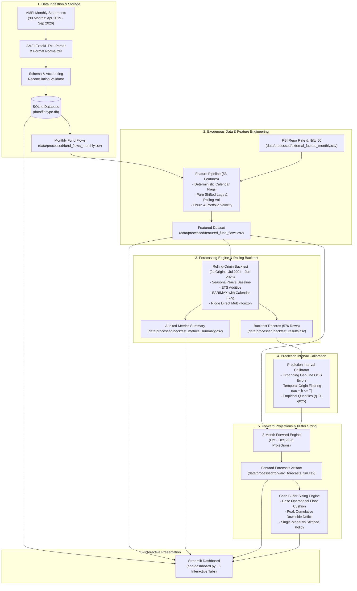

# FINHYPE — System Architecture & Data Flow

**System Architecture Specification**  
**Project:** FINHYPE (Zeckathon 2026 · Problem Statement 3)  
**Classification:** Quantitative Financial Forecasting & Treasury Liquidity Buffer Engine  

---

## 1. High-Level Architecture Overview

FINHYPE is structured as a modular, 6-stage quantitative forecasting and risk-management pipeline. The system enforces strict temporal isolation across all stages, ensuring that no future information leaks into historical models or risk buffers.

---

## 2. Stage-by-Stage Component Specifications

### Stage 1: Data Ingestion, Normalization & Storage
* **Source:** Official monthly statements published by the Association of Mutual Funds in India (AMFI).
* **Coverage:** Continuous monthly time series from April 2019 through September 2026 (90 observations per category, 180 total records).
* **Categories:** Indian `Liquid Fund` and `Overnight Fund`.
* **Parser (`app/data/amfi_parser.py`):** Normalizes heterogeneous multi-year header variations (`"Funds Mobilised"`, `"Funds Mobilized (Rs. in Crore)"`, `"Repurchase / Redemption"`) and handles regional thousand-separators (`1,23,456.78`).
* **Validator (`app/data/amfi_validator.py`):** Enforces fundamental accounting reconciliation invariance:
  $$\text{Discrepancy} = |\text{Net Flow} - (\text{Funds Mobilised} - \text{Repurchase})| \le 0.01\text{ INR Cr}$$
* **Database (`app/data/db.py`):** Normalizes storage into SQLite (`data/finhype.db`) with unique composite keys on `(month, category)` to prevent duplicate ingestion.

### Stage 2: Feature Engineering & Leakage Isolation
* **Macro Factors (`app/data/external_factors.py`):** Ingests historical RBI Monetary Policy Committee Repo Rate decisions and NSE Nifty 50 benchmark returns. Under multi-step forecasting, future macro changes are strictly held constant ($\Delta \text{Repo}_{T+h} = 0$).
* **Feature Pipeline (`app/forecasting/feature_engineering.py`):** Generates 53 domain-engineered indicators:
  1. *Deterministic Calendar Drivers*: Quarterly tax flags (`is_advance_tax_month`, `is_quarter_end`, `is_fy_end`), days in month, and trigonometric cyclical encoding (`sin_month`, `cos_month`).
  2. *Autoregressive Lags*: Pure shifted vectors (`.shift(1)`, `.shift(12)`) ensuring feature values at time $t$ depend strictly on observations at $t-1$ or earlier.
  3. *Rolling Volatility & Momentum*: 3-month and 6-month rolling means and standard deviations computed strictly on lagged series.
  4. *Portfolio Churn & Velocity*: Gross mobilization-to-AUM and redemption-to-AUM ratios.

### Stage 3: Forecasting Models & Rolling-Origin Backtesting
Four distinct forecasting model families evaluate direct multi-step horizons ($h \in \{1, 2, 3\}$):
1. **Seasonal-Naive (`SeasonalNaiveForecaster`)**: Annual persistence baseline: $\hat{Y}_{T+h|T} = Y_{T+h-12}$.
2. **ETS (`ETSForecaster`)**: Exponential Smoothing state-space model with additive error and trend.
3. **SARIMAX (`SARIMAXForecaster`)**: Seasonal $(p,d,q) \times (P,D,Q)_{12}$ ARIMA incorporating forward deterministic calendar regressors.
4. **Ridge Regression (`RidgeDirectForecaster`)**: L2-regularized linear model with separate direct regression heads for $h=1, 2, 3$, with internal feature standardization strictly fitted on historical training slices.

**Rolling-Origin Protocol (`app/forecasting/backtest.py`):**
* 24 expanding origins from July 2024 to June 2026.
* Generates 576 out-of-sample forecast records ($24 \text{ origins} \times 2 \text{ categories} \times 4 \text{ models} \times 3 \text{ horizons}$).
* Target month is strictly validated: $\text{target\_month} = \text{origin\_month} + h$.

### Stage 4: Prediction Interval Calibration
* **Engine (`app/forecasting/intervals.py`):** Horizon-specific empirical error distribution calibration.
* **Error Definition:** Realized out-of-sample error $e_{\tau, h} = Y_{\tau+h} - \hat{Y}_{\tau+h|\tau}$.
* **Temporal Safeguard:** A historical error from origin $\tau$ is accessible at forecast origin $T$ if and only if its target month is already realized:
  $$\tau + h \le T$$
* **Bounds Construction:**
  $$\hat{L}_{T+h}^{(80)} = \hat{Y}_{T+h} + \text{Quantile}_{0.10}(e_h), \quad \hat{U}_{T+h}^{(80)} = \hat{Y}_{T+h} + \text{Quantile}_{0.90}(e_h)$$
  $$\hat{L}_{T+h}^{(95)} = \hat{Y}_{T+h} + \text{Quantile}_{0.025}(e_h), \quad \hat{U}_{T+h}^{(95)} = \hat{Y}_{T+h} + \text{Quantile}_{0.975}(e_h)$$

### Stage 5: Cash Buffer Recommendation Engine
* **Service Module (`app/services/cash_buffer.py`):** Translates net flow forecasts and downside prediction intervals into actionable treasury buffers.
* **Sizing Formula:**
  $$\text{Recommended Buffer}_h = \max\left( \text{Base Operational Floor}, \; \text{Peak Cumulative Downside Deficit}_h \right)$$
  where:
  $$\text{Base Operational Floor} = b_{\text{base}} \times \text{AUM}_T$$
  $$\text{Cumulative Deficit}_k = \max\left(0, \; -\sum_{j=1}^k \hat{L}_{T+j}\right)$$
  $$\text{Peak Cumulative Deficit} = \max_{k=1..h} \text{Cumulative Deficit}_k$$
* **Policy Modes (`app/services/forward_forecasting.py`):**
  1. *Single-Model Trajectory (Production Baseline)*: Evaluates a single model family across all steps (Seasonal-Naive for multi-month Overnight, SARIMAX for Liquid).
  2. *Step-Wise Stitched Trajectory (Alternative)*: Stitches the step-wise empirical champion model at each horizon step with strictly matched model-specific error quantiles.

### Stage 6: Interactive Dashboard Architecture
* **Technology:** Streamlit web application (`app/dashboard.py`) with Plotly visualization.
* **Tabs Structure:**
  1. *Executive Summary*: Headline AUM, net flow, velocity metrics, and active recommendation card.
  2. *Historical Dynamics*: 90-month flow/AUM trajectory and calendar-month seasonality profile.
  3. *3-Month Forward Forecasts*: Multi-step point forecasts and fan bands (Oct–Dec 2026).
  4. *Cash Buffer Recommendation Engine*: Interactive buffer sizing, cumulative deficit progression, and policy comparison expander.
  5. *Model Benchmark & Backtest*: Audited 24-origin rolling backtest metrics, Skill Scores, and MASE.
  6. *Data Freshness & Methodology*: Data provenance, macro assumptions, and governance disclosures.

---

## 3. Data Integrity & Verification Contract

1. **Schema Monotonicity:** `validate_point_forecast_and_interval_compatibility` ensures $\text{lower}_{95} \le \text{lower}_{80} \le \text{upper}_{80} \le \text{upper}_{95}$ across all outputs.
2. **Zero In-Sample Residuals:** Intervals strictly use out-of-sample backtest errors; in-sample residuals are structurally prohibited.
3. **No Unwarranted Caps:** Buffer figures are not capped at 100% of AUM; extreme stress estimates are transparently communicated with comonotonicity disclosures.
4. **Automated Protection:** 154 automated tests across 12 test modules validate database constraints, feature isolation, backtest arithmetic, metric shapes, and financial calculation parity.

